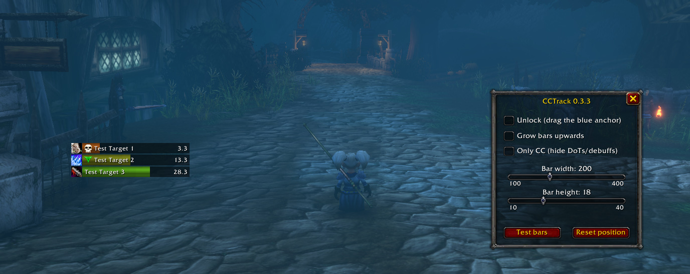

# CCTrack for WoW: Forever

**See how long your crowd control and debuffs have left, even across multiple targets.**

CCTrack shows timers for your own crowd control, silences, slows, and damage-over-time spells. Each bar shows the spell icon and seconds remaining, plus the target name and raid marker when available.

- Up to 24 bars across multiple targets
- Adjustable bar width, height, position, and growth direction
- **Only CC** mode for crowd control such as Polymorph, stuns, and roots
- Settings saved per character

For **WoW: Forever** (client 1.60.1, interface 16001). Version **0.1**.

## Tracked spells

- **Mage:** Polymorph, Frost Nova, Counterspell, Fireball, Pyroblast, Frostbolt, Cone of Cold
- **Warlock:** Fear, Howl of Terror, Banish, Death Coil, Corruption, Immolate, Siphon Life, Curse of Agony, Curse of Weakness, Curse of Recklessness, Curse of Tongues, Curse of the Elements, Curse of Shadow, Curse of Doom, Curse of Exhaustion
- **Priest:** Shackle Undead, Psychic Scream, Silence, Shadow Word: Pain, Devouring Plague, Holy Fire
- **Rogue:** Sap, Gouge, Blind, Cheap Shot, Kick, Garrote, Expose Armor
- **Druid:** Hibernate, Entangling Roots, Bash, Pounce, Rake, Rip, Moonfire, Faerie Fire, Faerie Fire (Feral), Demoralizing Roar
- **Hunter:** Wyvern Sting, Scare Beast, Scatter Shot, Serpent Sting, Viper Sting, Scorpid Sting, Hunter's Mark, Concussive Shot, Wing Clip
- **Paladin:** Hammer of Justice, Repentance, Turn Undead
- **Shaman:** Flame Shock, Frost Shock
- **Warrior:** Intimidating Shout, Concussion Blow, Shield Bash, Rend, Hamstring, Sunder Armor, Demoralizing Shout, Thunder Clap, Mortal Strike, Piercing Howl, Disarm

## Usage

**/cctrack** or **/cct** opens the settings. Use **Unlock** to drag the blue anchor and **Test bars** to preview the layout with three sample timers.

- **/cctrack** — open or close settings
- **/cctrack test** — toggle the sample bars
- **/cctrack unlock**, **/cctrack lock** — turn drag mode on or off
- **/cctrack cc**, **/cctrack all** — show only crowd control or all tracked effects
- **/cctrack reset** — reset the anchor position
- **/cctrack status** — list recognized spells and show whether aura data is readable
- **/cctrack probe** — report what the client exposes
- **/cctrack debug** — toggle diagnostic logging. The log is saved in `CCTrackDB.log` on reload or logout.

## How it works

- **When aura data is readable**, CCTrack matches your casts to debuffs on visible units and uses the game's duration when available.
- **When the client blocks aura access**, CCTrack estimates timers from your finished casts and the spell's rank. Recasting Frostbolt on the same selected target refreshes its timer even when the client hides the target name and GUID.

## Limits

- Coverage depends on the units the client exposes. Turn on enemy nameplates to track more targets.
- While aura access is blocked, a resisted spell can show a timer, and a broken effect can stay visible until the timer ends.
- Interrupt timers represent silence debuffs. Pure interrupts, traps, pet abilities, proc effects, Kidney Shot, and Rupture are outside the spell list.
- Spell matching uses English names.

## License

MIT
